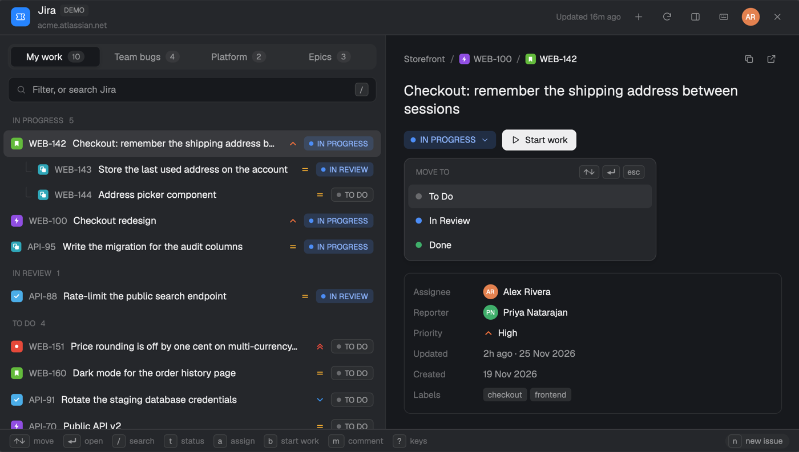
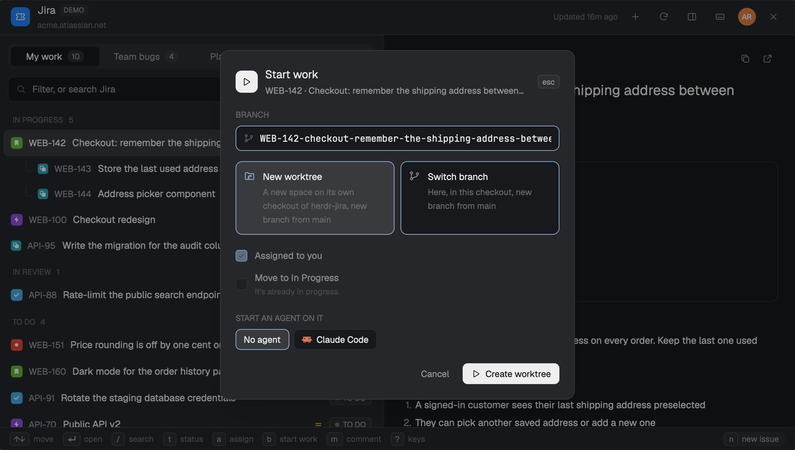
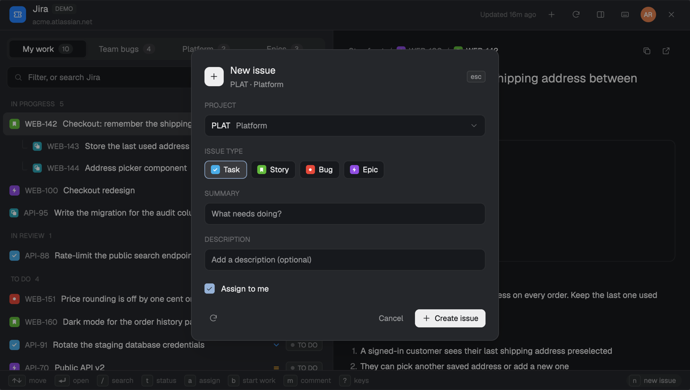
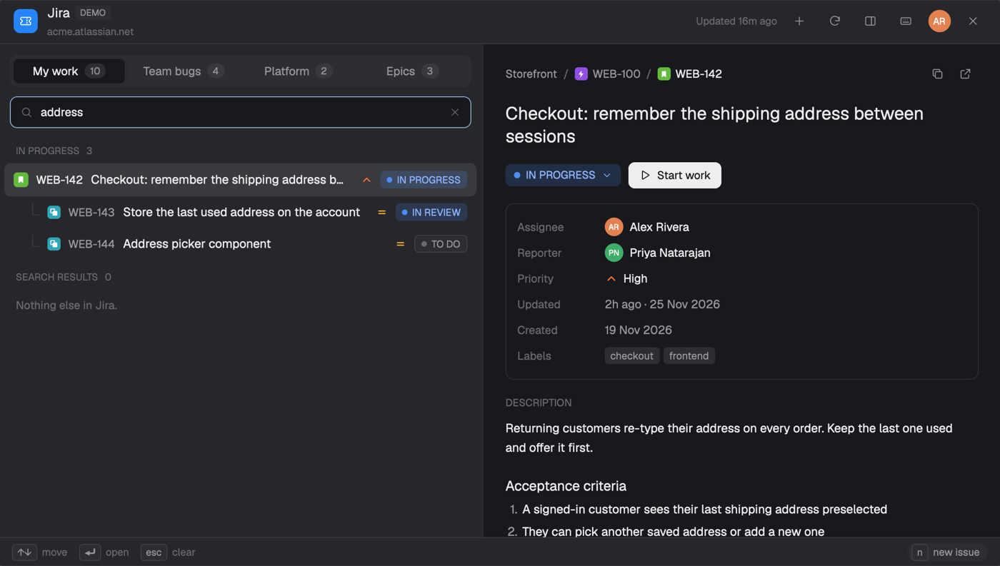
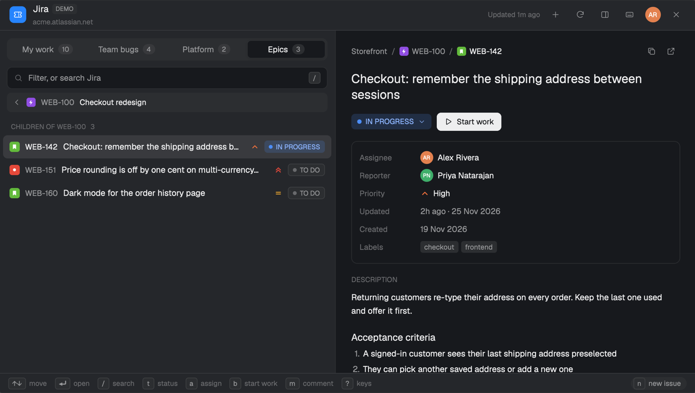
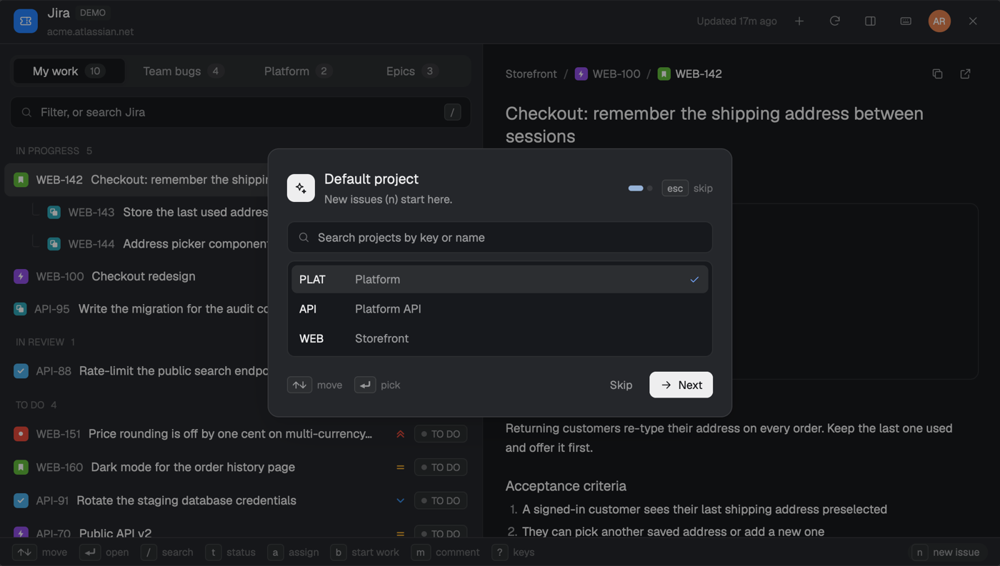
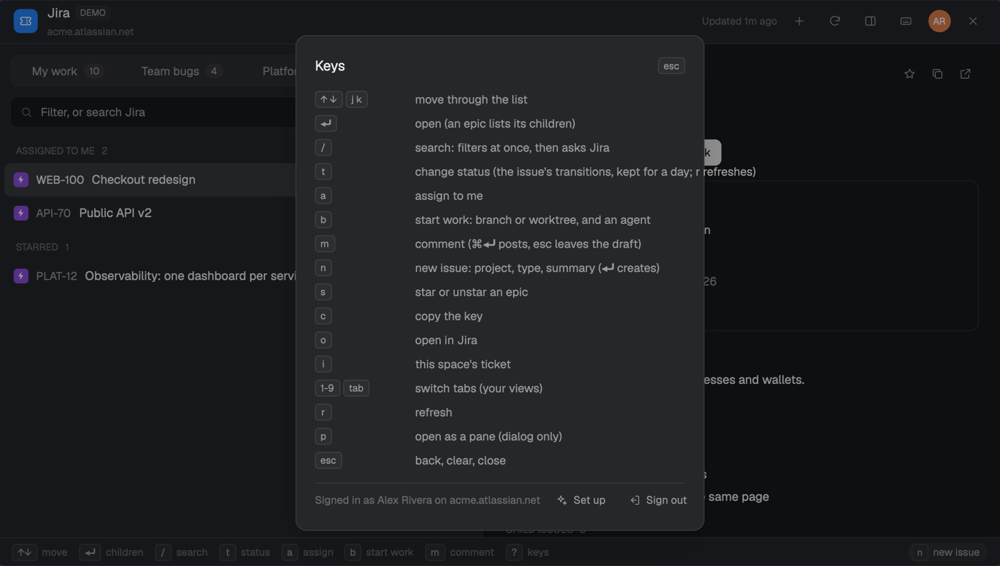

# Jira for the Herdr app

A mod for the [Herdr app](https://herdr.dev) that puts your Jira Cloud issues
beside your terminals. It is the app version of this repo's herdr plugin and
shares its sign-in, caches and stars, so you can use both.


- **Tabs you define** (see [Tabs](#tabs)): by default **My work**, everything
  assigned to you that isn't Done, under status headings (In Progress-type
  statuses first, then To Do) with counts and sub-tasks under their parent. Add
  Epics, your own JQL or saved Jira filters.
- **This space's ticket** at the top. The branch your space is on is matched to
  its Jira issue, and every row shows which spaces are working on it.
- **A detail pane** with the description and the latest comments rendered as
  markdown, plus sub-tasks, child issues, parent, assignee, priority and labels.
- **Add a comment** under the comments: `m` (or the "m comment" pill) focuses a
  multi-line box; `⌘⏎`/`ctrl-⏎` posts it as markdown, `esc` leaves it. The
  draft is kept per issue while the mod is open. The comment shows at once,
  then gives way to Jira's copy; if Jira refuses, the text goes back in the box
  with the reason.
- **Change status** from the issue's transitions, as Jira lists them. Nothing
  is hardcoded. Each workflow step's list is kept for a day; `r` refetches.
- **Start work**: a branch named after the issue, either as a new worktree
  space (nested under its repo in the sidebar) or checked out where you are.
  It can also assign the issue to you, move it to In Progress, and start an
  agent (Claude Code, Codex, anything Herdr knows) with the issue as its first
  message.
- **Quick create**: `n` (or the **+** in the header, or the "n new issue" pill in
  the footer) opens a compact form: project, issue type, summary, an optional
  description and "Assign to me" (on by default). `enter` creates, `esc` cancels.
  The project starts as your space's ticket's, else the last one you created in,
  else the first. Projects and issue types are cached for six hours; `r` in the
  form refetches. After creating you can open the issue, start work on it, or
  create another (the form keeps its project and type).
- **Search** filters your lanes as you type, then asks Jira for matches.
- **Mouse and keys** throughout, with a legend in the footer and `?` for all keys.

**It writes to Jira** when you ask it to: creating an issue, status changes,
assigning to you, and Start work's follow-ups. Stars stay on your machine.

## A tour

These screenshots are from the demo (`herdr-jira app install --demo`), a pretend
Jira site, so you can try every one of them without an account.

**Change status** (`t`): the issue's transitions, as Jira lists them.



**Start work** (`b`): a branch named after the issue, as a new worktree space or
checked out where you are, with the optional follow-ups and an agent to start.



**Quick create** (`n`): project, issue type, summary, and an optional
description.



**Search** (`/`): filters the tab at once, then asks Jira for anything else.



**Epics** (opt-in tab): `enter` on an epic lists its children.



**First run setup**: pick a default project, then your tabs.



**All keys** (`?`), with **Set up** and sign out.



## Tabs

Tabs come from the optional `views` list in the helper's `config.json`
(`~/.config/herdr/plugins/config/herdr-jira/config.json`). Without it you get
just **My work**.

```json
{
  "views": [
    { "builtin": "my-work" },
    { "builtin": "epics" },
    { "name": "Team bugs", "jql": "project = WEB AND type = Bug AND statusCategory != Done" },
    { "name": "Triage", "filter": 10234, "group_by": "none" }
  ]
}
```

- `{"builtin": "my-work"}`: assigned to you, not Done, any type (epics show as
  ordinary rows), grouped by status, latest update first.
- `{"builtin": "epics"}`: your epics and the ones you starred. Opt-in.
- `{"name", "jql"}`: any JQL. `{"name", "filter"}` runs a saved filter as
  `filter = <id>`.
- `group_by`: `"status"` (default) or `"none"` (Jira's order, no headings).
- Each tab shows one page of 50 (`50+`). Search filters the tab at once, then
  asks Jira within the tab's JQL. Invalid entries are skipped and a note in the
  app says why; the app never fails over config.
- Many tabs scroll sideways; `1`-`9` and `tab` switch.

## Install

Open the Herdr app once (so it has made its folder), then run:

```sh
curl -fsSL https://raw.githubusercontent.com/craicoverflow/herdr-jira/main/scripts/install-app.sh | sh
```

Press `cmd-j` in Herdr (`ctrl-shift-j` on Linux) to open it.

The script ([`../scripts/install-app.sh`](../scripts/install-app.sh))
downloads the `herdr-jira` binary for your platform (macOS or Linux, arm64 or
amd64) from the latest GitHub release. It checks the binary's SHA-256 against
the release's `checksums.txt` and runs `herdr-jira app install` with it. It
needs no Go and puts nothing on your `PATH`, and the download is deleted
afterwards. Running it again updates the mod to the latest release; if you're
already on the latest, nothing changes.

- **Options** go to `app install` after `sh -s --`. For example,
  `… | sh -s -- --demo` installs the demo, and `… | sh -s -- --no-key` skips
  the key binding.
- **A given release:** `… | HERDR_JIRA_VERSION=v0.5.0 sh`.
- **Uninstall:** `~/.config/herdr-app/mods/jira/.bin/herdr-jira app uninstall`
  removes the mod and its key binding.

**From a checkout** instead, build the binary and install with it:

```sh
sh scripts/build.sh            # in this repo: builds bin/herdr-jira
./bin/herdr-jira app install   # copies the mod in and binds cmd-j
```

`app install` copies the mod to `~/.config/herdr-app/mods/jira/` (or
`$HERDR_APP_HOME/mods/jira/`), puts a copy of the binary in the mod's hidden
`.bin/` folder as its helper, and adds `"cmd-j": "mod.open:jira"` to your
`keys.json` (`ctrl-shift-j` on Linux), unless that key is taken or something
already opens the mod. Run it again after updating to refresh both.
`--no-key` skips the binding; `herdr-jira app uninstall` removes the mod and
the binding.

**Try it without an account:** `herdr-jira app install --demo` shows a
pretend Jira site (Acme's checkout team) whose changes stay on your machine.
Reinstall without `--demo` to use your own.

## Use

- **`cmd-j`** opens Jira as a dialog. The ticket for the space you're in
  shows first.
- **Open as a pane** (the panel button in the header, or `p`) splits it in
  beside your terminals. In a pane narrower than 720 px the list and the
  detail take turns. You can also run
  `herdr-app do pane.split --direction right --mod jira`, or open it as a tab
  with `herdr-app do tab.new --mod jira --name Jira`.
- **First run** asks you to sign in with Atlassian in the browser. There is no
  API token to create, and no LLM sits between you and Jira. Then a short
  setup follows (see [First run setup](#first-run-setup)).

## First run setup

After sign-in the app offers a setup of at most three screens. Every step is
optional: `Skip` leaves what the step would change alone, `esc` skips the rest,
and it isn't offered again by itself. Run it any time from `?` then **Set up**.
It is not shown to anyone whose `config.json` already has `views` or
`default_project`.

1. **Site** (only when your account reaches more than one Jira Cloud site):
   pick one. It is stored the way a one-site account's is, so every part of
   the app and the terminal popup uses it.
2. **Default project**: search by key or name, `↑↓` and `⏎` (or click). Stored
   as `default_project`; quick-create starts on your space's ticket's project,
   else the last one you created in, else this one, else the first.
3. **Tabs**: My work is always on. Toggle Epics (`e`), and add JQL tabs (`a`):
   a name and a JQL, which is run once against Jira before the tab is added
   (Jira's own complaint is shown if it refuses). Jira's saved *filters* can't be
   listed (the Atlassian MCP has no tool for it), so a tab for one is
   `filter = 10234` as its JQL. Finish writes `views` and lands on My work.

Setup writes `config.json` through the helper (`herdr-jira api setup-save`),
which changes only `default_project` and `views`: every other key is kept as
written, a file that isn't valid JSON is left alone with an error, and the new
file replaces the old in one step. In the demo it writes to the demo's own
state, never your config.

| Key | Action |
|---|---|
| `↑` `↓` / `j` `k` | move |
| `enter` | open (an epic lists its children) |
| `/` | search: filters at once, then asks Jira |
| `t` | change status |
| `a` | assign to me |
| `b` | start work |
| `m` | comment (`⌘⏎` / `ctrl-⏎` posts, `esc` leaves the draft) |
| `s` | star or unstar an epic |
| `c` | copy the key |
| `o` | open in Jira |
| `i` | this space's ticket |
| `1`-`9` `tab` | switch tabs |
| `n` | new issue |
| `r` | refresh |
| `p` | open as a pane (dialog only) |
| `?` | all keys, **Set up**, and sign out |
| `esc` | back, clear the search, close |

While a copy is shown, keys in `keys.json` can reach it as `jira.<command>`.
The commands are `ticket`, `refresh`, `search` (or `search:<text>`),
`status`, `assign`, `start`, `star`, `copy`, `browse`, `next`, `prev`,
`open`, `back`, `issues`, `epics`, `keys`, `new` and `setup`. For example,
`"cmd-shift-j": "jira.ticket"` jumps to this space's ticket.

## How it works

The mod (`mods/jira/`) is gpui-kit JavaScript. Everything that touches Jira
goes through the helper, `herdr-jira api <op>`, which prints one JSON object
per call ([`../api.go`](../api.go)). The helper is the same binary the terminal
plugin uses: the OAuth sign-in against `mcp.atlassian.com` and the MCP calls
to Jira run there, and the tokens never reach the mod. The lists are cached on
disk (views for 30 minutes, Epics for 3 hours), so the dialog paints at once,
and so are the transitions from each workflow step (for a day), so the status
menu opens at once.
Each space's branch is matched to a ticket the way the plugin's sidebar label
is: Jira-shaped keys in the branch name, confirmed with Jira and cached.

Signing in runs in a background helper process, because the app gives each
program 30 seconds. The mod polls `herdr-jira api session` until you approve.

## Develop

```sh
node --test app/test/                      # the mod's pure logic
go test ./...                              # the helper and the installer
herdr-app check ~/.config/herdr-app/mods/jira
```

Edit `app/mods/jira/`, then `go build -o bin/herdr-jira . && ./bin/herdr-jira
app install` (the mod is built into the binary). The app reloads the mod as
soon as its files change. `herdr-app check` writes `jsconfig.json` and the
type files into whichever folder you check; they are gitignored and stay out
of the binary.
