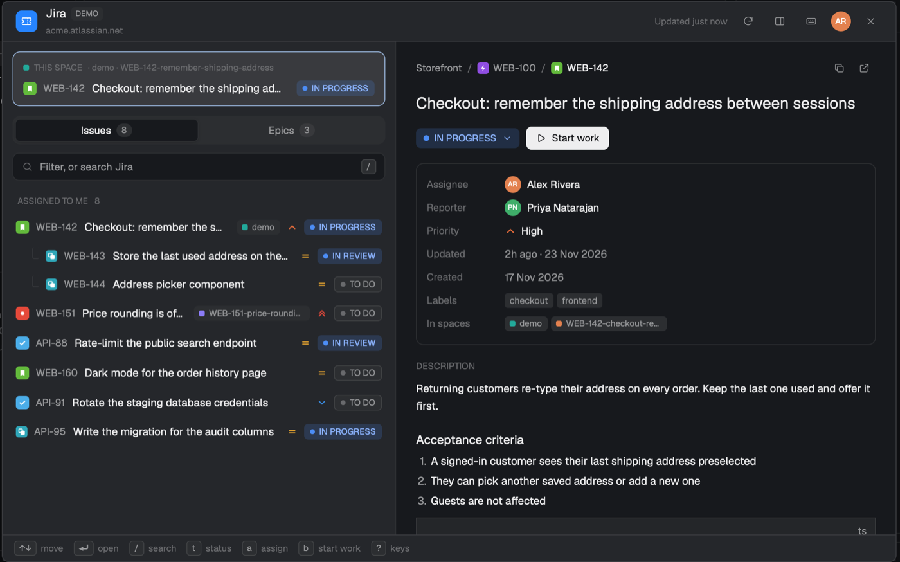

# Jira for the Herdr app

A mod for the [Herdr app](https://herdr.dev) that puts your Jira Cloud issues
beside your terminals. It is the app version of this repo's herdr plugin and
shares its sign-in, caches and stars, so you can use both.



- **Issues and Epics** in headed lanes: your open issues with sub-tasks under
  their parent, your epics, and the epics you starred.
- **This space's ticket** at the top. The branch your space is on is matched to
  its Jira issue, and every row shows which spaces are working on it.
- **A detail pane** with the description and the latest comments rendered as
  markdown, plus sub-tasks, child issues, parent, assignee, priority and labels.
- **Add a comment** under the comments: `m` (or the "m comment" pill) focuses a
  multi-line box; `⌘⏎`/`ctrl-⏎` posts it as markdown, `esc` leaves it. The
  draft is kept per issue while the mod is open. The comment shows at once,
  then gives way to Jira's copy; if Jira refuses, the text goes back in the box
  with the reason.
- **Change status** from the issue's transitions, as Jira lists them. Nothing
  is hardcoded. Each workflow step's list is kept for a day; `r` refetches.
- **Start work**: a branch named after the issue, either as a new worktree
  space (nested under its repo in the sidebar) or checked out where you are.
  It can also assign the issue to you, move it to In Progress, and start an
  agent (Claude Code, Codex, anything Herdr knows) with the issue as its first
  message.
- **Search** filters your lanes as you type, then asks Jira for matches.
- **Mouse and keys** throughout, with a legend in the footer and `?` for all keys.

**It writes to Jira** when you ask it to: status changes, assigning to you,
and Start work's follow-ups. Stars stay on your machine.

## Install

You need the `herdr-jira` binary: it signs you in to Atlassian and talks to
Jira, and it carries the mod.

```sh
# Prebuilt or from source: anything that gives you the herdr-jira binary.
sh scripts/build.sh            # in this repo: builds bin/herdr-jira
./bin/herdr-jira app install   # copies the mod in and binds cmd-j
```

`app install` copies the mod to `~/.config/herdr-app/mods/jira/` (or
`$HERDR_APP_HOME/mods/jira/`), puts a copy of the binary in the mod's hidden
`.bin/` folder as its helper, and adds `"cmd-j": "mod.open:jira"` to your
`keys.json` (`ctrl-shift-j` on Linux), unless that key is taken or something
already opens the mod. Run it again after updating to refresh both.
`--no-key` skips the binding; `herdr-jira app uninstall` removes the mod and
the binding.

**Try it without an account:** `herdr-jira app install --demo` shows a
pretend Jira site (Acme's checkout team) whose changes stay on your machine.
Reinstall without `--demo` to use your own.

## Use

- **`cmd-j`** opens Jira as a dialog. The ticket for the space you're in
  shows first.
- **Open as a pane** (the panel button in the header, or `p`) splits it in
  beside your terminals. In a pane narrower than 720 px the list and the
  detail take turns. You can also run
  `herdr-app do pane.split --direction right --mod jira`, or open it as a tab
  with `herdr-app do tab.new --mod jira --name Jira`.
- **First run** asks you to sign in with Atlassian in the browser. There is no
  API token to create, and no LLM sits between you and Jira.

| Key | Action |
|---|---|
| `↑` `↓` / `j` `k` | move |
| `enter` | open (an epic lists its children) |
| `/` | search: filters at once, then asks Jira |
| `t` | change status |
| `a` | assign to me |
| `b` | start work |
| `m` | comment (`⌘⏎` / `ctrl-⏎` posts, `esc` leaves the draft) |
| `s` | star or unstar an epic |
| `c` | copy the key |
| `o` | open in Jira |
| `i` | this space's ticket |
| `1` `2` `tab` | Issues / Epics |
| `r` | refresh |
| `p` | open as a pane (dialog only) |
| `?` | all keys, and sign out |
| `esc` | back, clear the search, close |

While a copy is shown, keys in `keys.json` can reach it as `jira.<command>`.
The commands are `ticket`, `refresh`, `search` (or `search:<text>`),
`status`, `assign`, `start`, `star`, `copy`, `browse`, `next`, `prev`,
`open`, `back`, `issues`, `epics` and `keys`. For example,
`"cmd-shift-j": "jira.ticket"` jumps to this space's ticket.

## How it works

The mod (`mods/jira/`) is gpui-kit JavaScript. Everything that touches Jira
goes through the helper, `herdr-jira api <op>`, which prints one JSON object
per call ([`../api.go`](../api.go)). The helper is the same binary the terminal
plugin uses: the OAuth sign-in against `mcp.atlassian.com` and the MCP calls
to Jira run there, and the tokens never reach the mod. The lists are cached on
disk (Issues for 30 minutes, Epics for 3 hours), so the dialog paints at once,
and so are the transitions from each workflow step (for a day), so the status
menu opens at once.
Each space's branch is matched to a ticket the way the plugin's sidebar label
is: Jira-shaped keys in the branch name, confirmed with Jira and cached.

Signing in runs in a background helper process, because the app gives each
program 30 seconds. The mod polls `herdr-jira api session` until you approve.

## Develop

```sh
node --test app/test/                      # the mod's pure logic
go test ./...                              # the helper and the installer
herdr-app check ~/.config/herdr-app/mods/jira
```

Edit `app/mods/jira/`, then `go build -o bin/herdr-jira . && ./bin/herdr-jira
app install` (the mod is built into the binary). The app reloads the mod as
soon as its files change. `herdr-app check` writes `jsconfig.json` and the
type files into whichever folder you check; they are gitignored and stay out
of the binary.
