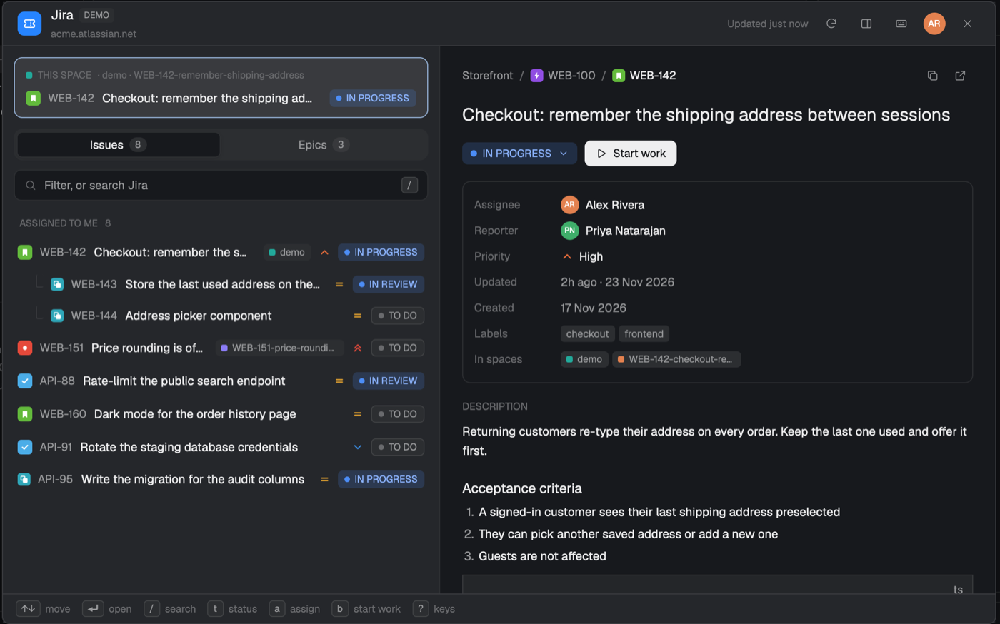

# Jira

Your Jira Cloud issues in a Herdr dialog, or in a pane beside your terminals:
Tabs (views) of status-headed lanes, the ticket your space's branch names pinned
on top, and a detail pane where you change status, assign the issue to
yourself, or start work on it in a new worktree space with an agent.

## What you see

A dialog 1080 px wide and 86 % of the window tall (`mod.open:jira`), or the
same view in a pane. Theme colors throughout; Jira's own hues for issue types
and statuses.

- **Header, 48 px.** A 26 px blue (`#2684ff`) rounded tile with a ticket glyph,
  "Jira" at 14 px semibold, and the site host (`acme.atlassian.net`) below it
  at 11 px dim. A DEMO badge in demo mode. On the right: "Updated 3m ago",
  then refresh, open as a pane, keys, the signed-in user's initials avatar
  (24 px circle), and close. These are ghost buttons, 28 px.
- **List column**, 44 % of the width (360 to 520 px) when the view is at
  least 720 px wide, else the full width:
  - *This space* card: a 9 px-radius card with a 7 px space-color square,
    "THIS SPACE · <space> · <branch>" at 10.5 px dim, then the issue row. Accent
    border while it is the one shown.
  - Segmented tabs, one per configured view (My work by default), with count
    pills, on `raised`. The active tab is a `background` pill with a border and
    a small shadow. Up to four share the row equally; more keep their natural
    width and scroll sideways, the active one kept in view. Keys `1`-`9` and
    `tab` switch. A dismissible amber note under the tabs says why config
    entries were skipped.
  - Search box, 34 px: a search glyph, the input, and a `/` key cap. A spinner
    shows while Jira answers.
  - A virtual list of lanes. Headings are 32 px, uppercase 10.5 px dim, with a
    count (`50+` when Jira has more). Rows are 36 px (sub-tasks 34 px), and
    hold: a 16 px type tile (bug `#e5493a` dot, story `#63ba3c` bookmark, task
    `#4bade8` check, epic `#904ee2` bolt, sub-task `#2fa6b8` squares, white
    glyph), the key in `muted`, the summary, a chip for each space on this
    ticket, a gold star on starred epics, a priority mark (red double chevron
    down to blue double chevron), and a status lozenge. The selected row is
    `selected`. Sub-tasks are indented 20 px with an L-shaped connector.
- **Detail column** on `surface`, scrolling: a breadcrumb (project / parent /
  key), star, copy and open-in-Jira buttons, the summary at 19 px semibold,
  then the status lozenge with a caret and Assign to me / Start work (solid)
  buttons. Below that, a fields card (Assignee and Reporter with avatars,
  Priority, Updated, Created, Labels, the spaces on this ticket), then the
  description as markdown, sub-tasks or child issues as small bordered rows,
  and the comments as bubbles beside avatars, newest first. Under them sits
  the comment box: a 24 px avatar, then a `background` card with a 1 px
  `border` (`accent` while focused, `blocked` after a failed post) around a
  multi-line text area (3 rows, growing to 10; 12.5 px). Below it a 11 px
  hint row (`⌘⏎` post, `esc` leave the draft) and a small blue "Comment"
  button, disabled while the box is blank. A comment just posted shows at 65 %
  opacity, dated "just now", until Jira's own copy replaces it. A failed post
  puts a `blocked`-tinted line under the box with Jira's reason in plain
  words. The footer shows the "m comment" pill in the legend; while the box
  has the keyboard it shows `⌘⏎ post` and `esc leave the draft`.
- **Footer, 32 px**: key caps and labels for the current mode, or the last
  notice ("WEB-143 is now In Progress", a check in `done`, an alert in
  `blocked`).
- **Status lozenges**: uppercase 10.5 px semibold, a 6 px dot. To do is
  `raised` with a border; in progress is blue (`#8cb4ff` on dark, `#1d4fb8` on
  light, on `#4c8df6` at 18 %); done is green (`#7fd69b` / `#1d7a3e` on
  `#3fae6a` at 18 %).

## How it behaves

- Opens on the ticket the focused pane's (else the space's) branch names, when
  Jira confirms one. Arrow keys or a click move to the lists. The detail
  follows the selection after it rests for 140 ms.
- `/` focuses the search: lanes filter at once, and after 300 ms Jira is
  searched within the tab's JQL (key prefix for `PROJ-12`, summary otherwise).
  Hits fill a Search results lane without repeating rows. `esc` clears it.
- `t`, or a click on the lozenge, opens a "MOVE TO" list under it with the
  issue's transitions (kept a day per workflow step). `↑↓` and `enter` move
  the issue, which updates everywhere at once.
- `enter` on an epic lists its children, with a back bar; `esc` returns.
- `b`, or Start work, opens a sheet over the view: a branch name
  (`KEY-short-summary`), New worktree (a new space at
  `~/.herdr/worktrees/<repo>/<branch>`) or Switch branch (here), Assign to me,
  Move to In Progress, and an agent to start with the issue as its task. The
  agent's choice is remembered.
- `s` stars an epic (local only), `a` assigns to you, `c` copies the key, `o`
  opens Jira, `r` refreshes, `?` lists the keys and offers Sign out.
- Signed out, the view is a "Connect Jira" card with Sign in with Atlassian.
  While you approve in the browser it shows a spinner and "Open the sign-in
  page again".
- Agent statuses are not shown; this mod is about tickets.

## Built from

- One mod, `mods/jira/`: `main.js` (the view), `model.js` (lanes and pure
  helpers), `ui.js` (tiles, lozenges, buttons), `api.js` (the helper),
  `start.js` (branches and worktrees), `icons/`. `mod.json`:
  `{"place": "none", "focusable": true, "overlay": {"kind": "dialog", "width": 1080, "height": 0.86}}`.
- `herdr`: `spaces`, `panes`, `focused`, `theme`, `settings`, `props`,
  `closeOverlay`, `run` (`pane.split`, `space.new`, `tab.new`,
  `space.select`), `notify`, `knownAgents`, `home`, `exec`, `nextCommand`,
  `shared("space.colors")` for space chips.
- gpui-base: `v_virtual_list` with `on_item_click`, `Scrollbar`, `InputState`
  and `Input`, `TextView.markdown`.
- The program `herdr-jira` (Go, this repo): `herdr-jira api <op>` prints one
  JSON object. It does the Atlassian OAuth (dynamic client registration and
  PKCE) and MCP calls to `mcp.atlassian.com`, and keeps the caches. It also
  runs `git` for Start work. The mod reaches the network only through it.

## Watch out

- Programs run by a mod get 30 seconds, so sign-in starts a detached helper and
  the mod polls `api session`.
- Virtual list rows can't have their own click handlers; the list reports the
  row's key. Star, copy and similar actions live in the detail pane.
- A `Popover`/`Popup` inside the scrolling detail did not paint; the
  transitions list is drawn inline under the lozenge instead.
- `h_flex()` centers its children vertically, so give a scrolling column
  `h_full()` or it collapses to nothing.
- One Jira Cloud site per account; each lane shows one page of 50.

## Done when

- `herdr-app check mods/jira` passes, and the dialog opens with `cmd-j`.
- With `herdr-jira app install --demo`, the tabs are My work, Team bugs (custom
  JQL), Platform (a saved filter, ungrouped) and Epics. My work groups under IN
  PROGRESS, IN REVIEW and TO DO with WEB-143 and WEB-144 indented under
  WEB-142; Epics shows 2 assigned and 1 starred (PLAT-20 is Done and hidden).
- A space on branch `WEB-142-…` shows the This space card and a chip on the
  WEB-142 row.
- `t`, `↓`, `enter` on WEB-143 moves it, and the row, the detail and the footer
  all say so.
- Start work on a repo's space creates `~/.herdr/worktrees/<repo>/<branch>` and
  a new space nested under the repo.
